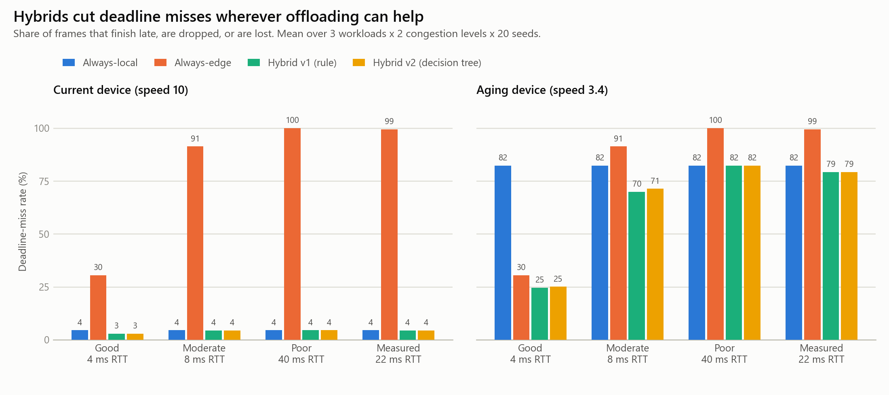

# Learning-Based Adaptive Resource Offloading for Gaming Applications in Edge Computing

NET 470 Cloud Networking Technologies, DePaul University, Fall 2026
Riffa Hammed and Cameron Siguenza

A Python simulator that decides, for every rendered frame of a game, whether to render it
**locally** on the player's GPU or **offload** it to a nearby edge server. A frame at 60 fps has a
16.67 ms deadline, so the decision has to account for the device's speed, the queue of frames
already waiting, the network (latency, bandwidth, jitter, loss) and how busy the edge server is.

Four strategies are compared: always-local, always-edge, a deadline-aware rule (hybrid v1) and a
decision tree trained on simulated outcomes (hybrid v2).

The games, the GPUs and the edge server are **simulated**. The device speeds and one network
profile are **measured** on two real laptops with `calibration_tool/calibrate.py`; everything else
is an assumption, listed below.

## Quick start

Python 3.10 or newer.

```
pip install -r requirements.txt
python calibrated_model/run_experiments.py        # about 1 minute, writes results_calibrated.csv
python calibrated_model/make_figures.py           # figures/*.png and figures/summary_tables.csv
python calibrated_model/make_report_figures.py    # figures/report/*.png (one IEEE column wide)
```

The scripts can be run from any folder. `model.py`, `workload.py` and `local_sim.py` each print a
small demo when run on their own (Eq. 1 and 2 for fixed jobs, the job stream, the local-only queue).

## Repository layout

```
calibrated_model/              main simulator (measured device speeds + measured network)
    model.py                   Device / Network / Job, Eq. 1 (t_local) and Eq. 2 (t_edge), parameters
    workload.py                one job per frame, lognormal work, presets light / moderate / heavy
    local_sim.py               local GPU queue with a render-ahead limit of 2 frames
    sim.py                     the four strategies, decision-tree training, the full simulation
    run_experiments.py         evaluation grid -> results_calibrated.csv
    results_calibrated.csv     192 rows, mean and std over 20 seeds
    make_figures.py            presentation-style figures -> figures/
    make_report_figures.py     report-sized figures -> figures/report/
original_placeholder_model/    the same simulator before calibration (baseline for comparison)
    results.csv                144 rows (3 networks, no measured profile)
calibration_tool/
    calibrate.py               measures GPU/CPU speed, network, and game frame times
    README.md                  how to run it on another laptop
    measurements/              raw measurements and how the model values were derived
requirements.txt
```

## How the simulator works

**Jobs** (`workload.py`). One rendering job per frame, arriving every 16.67 ms. The work per job is
lognormal (sigma = 0.3) with mean 50, 80 or 120 work units (light / moderate / heavy), seeded so
runs are reproducible.

**Local time, Eq. 1** (`model.py`, `local_sim.py`). `T_L = Q_L + W / F_L`: the wait behind frames
already queued plus the work divided by the device speed. Jobs run first in, first out. At most 2
frames may wait (the GPU render-ahead limit); further frames are dropped.

**Edge time, Eq. 2** (`model.py`, `sim.py`).
`T_E = L_net + D_in / B_up + Q_E + W / F_E + D_out / B_down`: latency, upload (0.2 Mb), waiting at
the shared edge server, edge compute, download (0.4 Mb). The edge wait `Q_E` drifts over time as an
AR(1) process. The decision engine only sees the value reported for the previous job, and the
actual edge time also gets Gaussian jitter and a chance of packet loss.

**Strategies** (`sim.py`).
- *Always-local* and *always-edge*: baselines.
- *Hybrid v1* (Eq. 3): run locally if `T_L + M <= D`; otherwise offload if `T_E + M <= D`;
  otherwise pick the faster one (`M` = 1 ms margin, `D` = 16.67 ms).
- *Hybrid v2*: a scikit-learn decision tree (depth 6, 60 leaves). It is trained on 20,000 random
  situations, each labelled with the choice that worked best in hindsight (using the true jitter,
  edge delay and loss). Inputs: local and edge slack (`D - T_L`, `D - T_E`, Eq. 4), job size,
  local queue wait, jitter, loss rate, reported edge delay and latency. Held-out accuracy 94.1%.

**Evaluation** (`run_experiments.py`). 2 devices x 3 workloads x 4 networks x 2 edge-congestion
levels x 4 strategies, 600 frames (10 s of play) each, averaged over 20 seeds. For each seed all
four strategies face the same frames, jitter, losses and edge delays, so the comparison is fair.
Metrics: deadline-miss rate (late + dropped + lost), average lateness, edge processing time (a
proxy for provider cost), share of frames offloaded and data sent.

## What is measured and what is assumed

| Parameter | Value | Source |
|---|---|---|
| Current device speed | 10 | Reference (RTX 5070 Ti laptop); only ratios matter |
| Aging device speed | 3.4 | **Measured**: GTX 1660 Ti runs at 34.2% of the RTX 5070 Ti (matrix-multiply benchmark, 3 runs each) |
| Measured network | 22 ms RTT, 7 ms jitter, 0.3% loss, 44 Mbps up, 150 Mbps down | **Measured**: medians of 4 runs on 2 laptops (home internet, not an edge deployment) |
| Edge server speed | 25 | Assumed (2.5x the reference) |
| Good / moderate / poor networks | 4 / 8 / 40 ms RTT, see `model.py` | Assumed edge scenarios |
| Workload sizes and spread | 50 / 80 / 120 units, sigma 0.3 | Assumed (real frame times not captured yet) |
| Data per frame | 0.2 Mb up, 0.4 Mb down | Assumed |
| Edge congestion | mean `Q_E` 1 ms (low) / 6 ms (high) | Assumed |
| Render-ahead limit, margin | 2 frames, 1 ms | Assumed |

Details and raw runs: `calibration_tool/measurements/MEASUREMENTS.md`.

## Results

Deadline-miss rate (%), averaged over all workloads, networks and congestion levels
(`results_calibrated.csv`):

| Strategy | Current device | Aging device | Both | Edge time (s per 10 s) | Offloaded |
|---|---|---|---|---|---|
| Always-local | 4.4 | 82.3 | 43.4 | 0.00 | 0% |
| Always-edge | 80.3 | 80.3 | 80.3 | 1.95 | 100% |
| Hybrid v1 (rule) | 4.0 | 64.0 | 34.0 | 0.58 | 22.3% |
| Hybrid v2 (tree) | 4.0 | 64.5 | 34.2 | 0.48 | 18.1% |

Miss rate (%) by network, both devices:

| Strategy | Good (4 ms) | Moderate (8 ms) | Measured (22 ms) | Poor (40 ms) |
|---|---|---|---|---|
| Always-local | 43.4 | 43.4 | 43.4 | 43.4 |
| Always-edge | 30.4 | 91.3 | 99.4 | 100.0 |
| Hybrid v1 | 13.7 | 37.1 | 41.8 | 43.4 |
| Hybrid v2 | 13.9 | 37.8 | 41.8 | 43.4 |



Main observations:
- In all 48 scenarios v1 is never worse than the better of the two baselines, and v2 is at most
  0.6 points worse. Both help most on the aging device with a nearby edge (aging device, good
  network: 82% -> about 25% missed frames).
- The measured home round trip (22 ms) is already longer than a frame, so per-frame offloading over
  ordinary internet rarely meets the deadline (always-edge misses 99.4%).
- v2 ties v1 on misses but offloads less and uses about 17% less edge time.

**Effect of calibration.** On the same three networks, replacing the placeholder aging-device speed
(4.0) with the measured 3.4 raises the miss rate of always-local from 38.3% to 43.4%, v1 from 27.6%
to 31.4% and v2 from 27.8% to 31.7%; the ranking of the strategies does not change
(`figures/fig4_calibration_effect.png`).

## The two model folders

`original_placeholder_model` is the simulator as it was before calibration and is kept as the
baseline for the comparison above. `calibrated_model` differs in three ways:
1. aging-device speed 4.0 -> 3.4 (measured);
2. the measured network profile was added as a fourth network;
3. negative jitter can now reduce the network latency at most to zero (before, only the total edge
   time was clamped at zero). This changes the results by at most 0.1 percentage point and moves
   the tree's held-out accuracy from 93.8% to 94.1%.

## Limitations and next steps

- Real game frame times have not been captured yet, so the workload sizes are assumptions.
  `python calibration_tool/calibrate.py frames log.csv` reads a PresentMon or CapFrameX log and
  gives the frame-time distribution to replace them.
- The edge server speed needs a source (e.g. a datacenter GPU spec sheet) or a sensitivity
  analysis over several values.
- The measured network is a home connection to public servers, not an edge deployment.
- The decision tree does not yet beat the rule on deadline misses.
